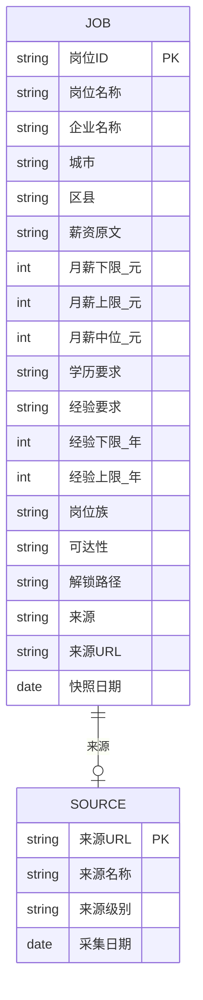
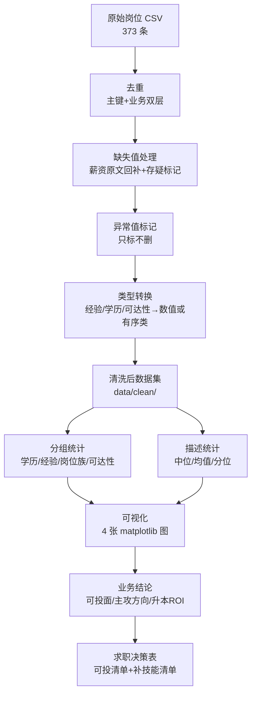

# 面试准备 · 口述稿 + 提问清单 + 流程图

> 适用场景：企业大数据 / 数据处理岗位面试官｜ 时长：口述 2 分钟，问答可延展 10–15 分钟
> 配套：本文件含 Mermaid ER 图、数据流程图，可直接粘进支持 Mermaid 的作品集页面。

---

## 一、2 分钟项目口述稿（背熟版）

> 面试官好。我分享的项目叫《成都大数据岗位情报分析》，是我为**解决自己的求职困惑**做的——作为一个专科大数据技术专业的学生，我不确定在成都到底能投什么岗、该补什么技能。所以我没有泛泛地爬数据，而是把它当成一个**业务问题**来拆解。
>
> 我采集了 373 条成都大数据相关岗位的公开信息，每条都保留了来源链接和采集日期，保证可溯源。清洗阶段我做了四件事：去重（主键+业务双层）、缺失值回补并打存疑标记、异常值只标记不删行、把经验和学历转成可计算的数值类型。这一步我特意**不盲目删数据、不瞎填缺失**，因为严谨比好看重要。
>
> 分析阶段我搭了一个**高职可达性三层模型**：L1 现在能投、L2 跳一跳可达、L3 暂不可达，再标注专升本解锁路径。最后得出四个落地结论：第一，薪资看中位数 18k 而不是被均值 22k 带偏；第二，学历有溢价但"学历不限"岗反超本科，说明能力能对冲学历；第三，**真实可投面有 63.8%**，其中 216 个岗靠专升本解锁，升本是 ROI 最高的杠杆；第四，主攻方向是**数据开发/ETL**，占了 35% 的岗位量且专科可达性最高。
>
> 我还诚实地披露了两个局限：主数据集技能列因为详情页验证码整列缺失，所以我换了另一份数据集做技能分析并注明了边界；大专样本只有 17 个，所以学历溢价的方向可信但数值不宜过度解读。我觉得这个项目最有价值的地方，不只是结论，而是它展示了我**完整严谨的分析链路和数据边界意识**。谢谢。

---

## 二、常见面试提问清单 + 参考回答

### Q1：你这个项目的数据从哪来？合法吗？
**答**：来自招聘网站公开发布的岗位信息，采集时我先读 robots.txt、单线程限速 2–3 秒、单轮不超过 25 次；**绝不采集任何求职者个人信息**，不绕过验证码，原始数据不外传，只发布聚合统计。每一步都留了来源 URL 和快照日期。

### Q2：为什么用中位数而不是均值？
**答**：因为薪资分布右偏——少数 30k+ 的架构/资深岗把均值拉到 22k，而中位数只有 18k。中位数更能代表"大多数岗位的薪资水位"，汇报时用中位数才不会被极端值误导。

### Q3：你这个"可达性分层"是怎么分的？主观吗？
**答**：是我基于"专科 + 专升本计划"这个个人画像做的**主观标注**，L1 学历经验完全匹配、L2 补一项能力或 1–2 年经验可达、L3 需先解决学历硬门槛。我在报告里明确写了这是主观判定、unlock_by 是建议而非承诺——它用于给自己做决策参考，不是给企业的客观标准。

### Q4：技能字段缺失你怎么办的？
**答**：主数据集 373 条技能整列缺失（详情页触发验证码）。我的处理是**不编造、不填补**，而是换用另一份带技能标签的 1200 条数据集，并且先做覆盖率审计——发现大数据类覆盖率 82%、数据分析类只有 14%，所以只对可信子集下结论。这种"先审计再推断"的判断本身就是加分点。

### Q5：数据中台薪资 45k，是不是最值得学？
**答**：不一定。那个"溢价"是拿"标题含该词的岗位"去比整体中位，但标题自带职级信号——含"数据中台"的多是资深架构岗，薪资天然高。所以这个指标衡量的是"关联什么档次岗位"，不是"学会能涨多少薪"。要真测回报得控制职级/经验做回归，超出当前数据范围。我能讲清这个陷阱，比背一个数值更有价值。

### Q6：专科生在大数据岗是不是没机会？
**答**：客观说，大数据岗本身对专科不友好——大数据类样本里大专只占 4.3%，76.6% 要求 3 年以上经验。但我的项目量化出**整体可投面仍有 63.8%**（含数据开发/ETL、数据分析运营、数据运维等 L2 岗），且专升本能再解锁一大批。我的策略是：升本 + 从 L2 切入 + 用作品集项目对冲"经验不足"。这不是画饼，是把门槛说清楚后的可执行路径。

### Q7：你用到哪些工具/技术？
**答**：Python 做清洗和 EDA（pandas 风格的 csv/re 处理），matplotlib 画图，输出自包含 HTML 看板（纯 SVG，可离线打开）。我个人更看重**工程严谨性**：清洗留痕、异常只标不删、结论可溯源。

### Q8：如果让你再做一遍，你会改进什么？
**答**：四点——① 扩源扩量到 ≥800 条、并入官方公共招聘网提升代表性；② 做周级快照看趋势；③ 攻克验证码回填真实技能字段做 JD 级词频；④ 把看板接成可交互 Web，支持按岗位族/区县筛选并输出《可投岗位清单》。

---

## 三、ER 图（数据模型）



> 说明：核心事实表 `JOB` 通过 `来源URL` 关联到 `SOURCE` 维表，保证每条岗位记录可溯源；`可达性`/`解锁路径` 为分析衍生字段，非源站原始字段。

---

## 四、数据处理流程图



---

## 五、发布到作品集网站（GitHub Pages）指引

### 方式 A：GitHub Pages（推荐，免费、稳定）
1. 在 GitHub 新建仓库（如 `cd-bigdata-job-analysis`），把本项目全部文件推送上去。
2. 仓库 **Settings → Pages → Build from branch → 选 `main` / `master`，目录选 `/root`**。
3. 约 1 分钟后访问 `https://<用户名>.github.io/cd-bigdata-job-analysis/`。
4. 把 `项目完整报告.md` 作为首页内容（或重命名为 `index.md` / `README.md` 即首页）。

```bash
git init
git add .
git commit -m "feat: 成都大数据岗位分析求职作品集"
git branch -M main
git remote add origin https://github.com/<用户名>/cd-bigdata-job-analysis.git
git push -u origin main
```

### 方式 B：Vercel / Netlify（静态托管）
- 适合挂交互式看板 `成都数据岗位_可视化看板.html`：在 Vercel 导入仓库、指定该 HTML 为入口即可获得独立链接。

### 方式 C：WorkBuddy 自带部署
- 可用 WorkBuddy「发布为应用」能力将本项目作为静态站点一键发布，获得可分享链接（详见 WorkBuddy 发布功能）。

### 本地预览（不发布也能看）
- 双击 `成都数据岗位_可视化看板.html` 即可离线查看全景看板；
- 报告内的 4 张图位于 `docs/figures/`，本地 Markdown 预览或用 VS Code + Markdown Preview 即可看到。
